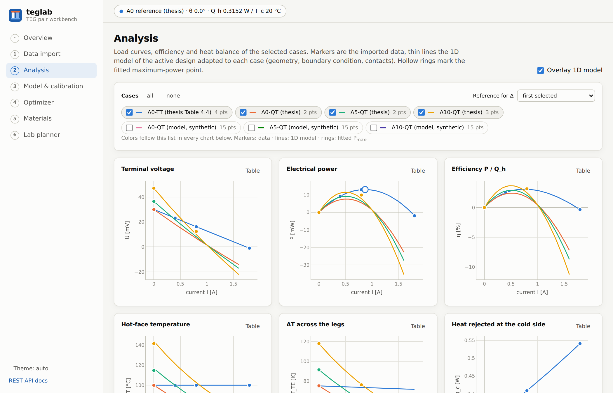
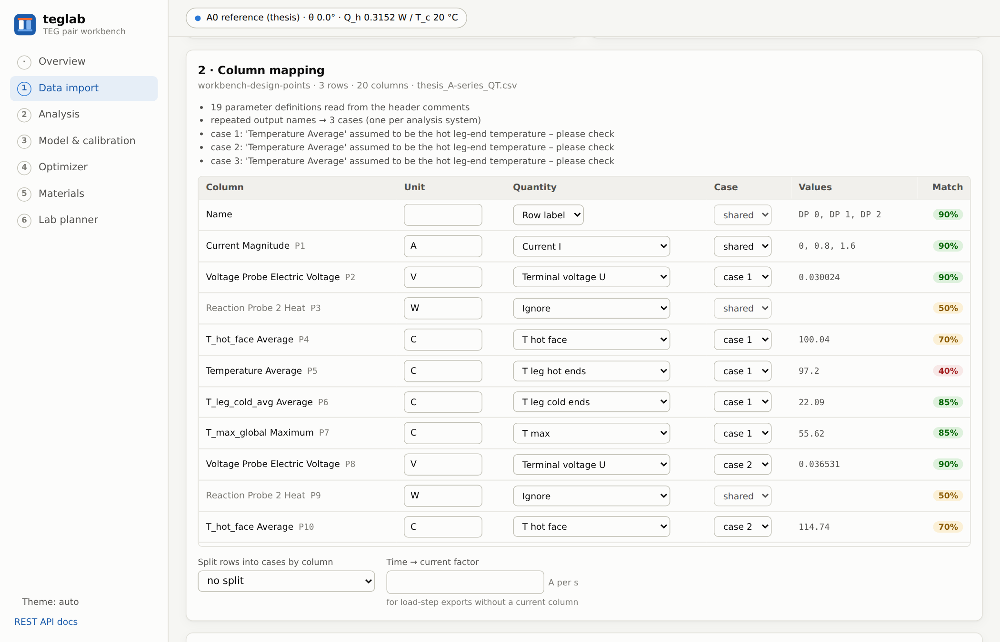
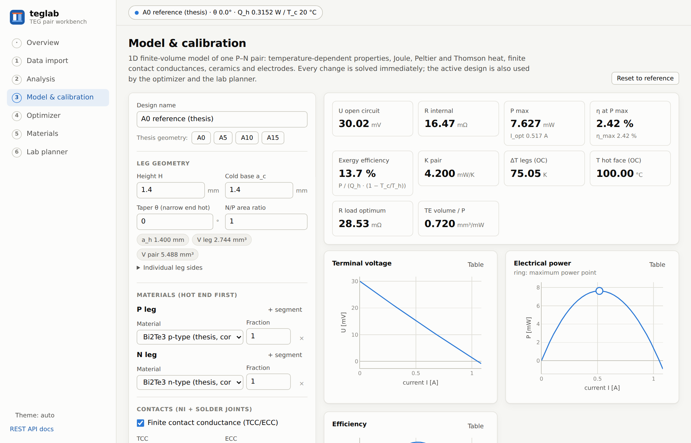
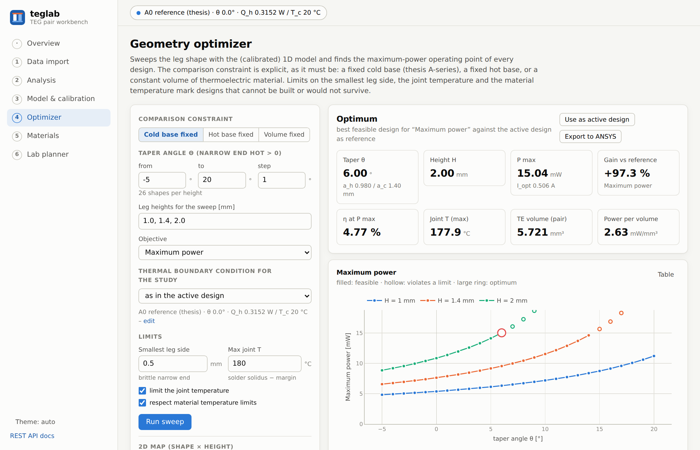
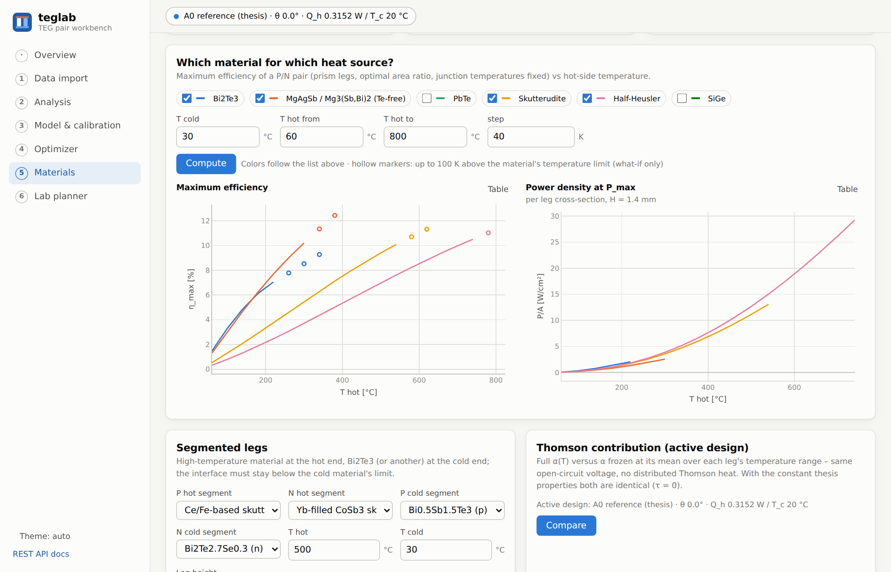
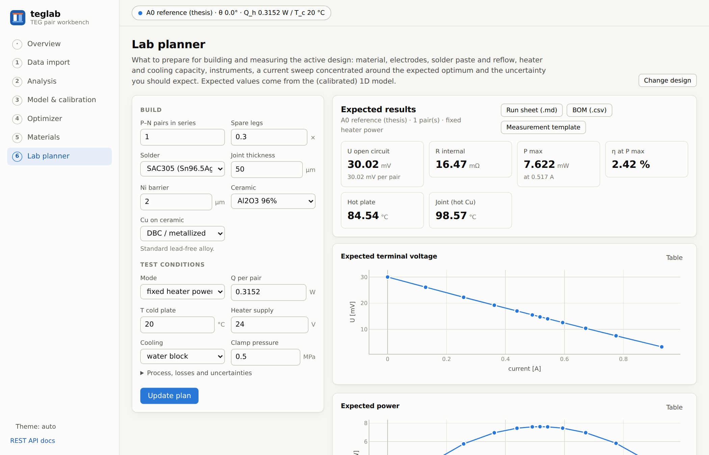
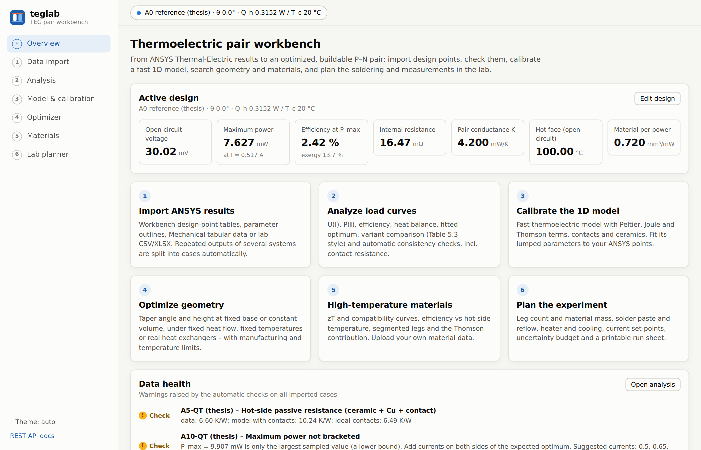

# teglab - thermoelectric pair workbench

**From ANSYS Thermal-Electric results to an optimized, buildable Peltier/TEG pair.**
Import design points from ANSYS Workbench, check them automatically, calibrate a fast 1D model on them,
search leg geometry (including constant-volume designs) and high-temperature materials, and plan the
soldering and the measurements in the lab - in one web app.




The project grew out of my master's thesis *Numerical analysis and optimization of Peltier thermoelectric
modules* (Warsaw University of Technology, Faculty of Power and Aeronautical Engineering, 2026) - a 3D
thermal-electric FEM study of a TEC1-12706 unit cell with prismatic and frustum-shaped legs. teglab turns that
one-off study into a reusable tool; the thesis results are reproduced by the model and the comparison runs in the
test suite ([validation report](docs/validation.md)).

---

## What it does

| Page | What you get |
| --- | --- |
| **Data import** | Drop Workbench *Table of Design Points* CSVs, *Outline of Parameters*, Mechanical *Tabular Data* (paste) or lab CSV/XLSX. Units, decimal commas and sign conventions are normalized; repeated outputs of several analysis systems are split into cases automatically; every column gets a suggested physical meaning with a confidence score. |
| **Analysis** | U(I), P(I), η(I), hot-face temperature, ΔT and heat balance of all cases with the 1D model overlaid; fitted P<sub>max</sub> (local parabola / spline, not just the largest sample); variant comparison in the style of thesis Table 5.3; automatic consistency checks (energy balance, sampling around P<sub>max</sub>, effective Seebeck, implied internal and contact resistance, passive layers, conductance); Roache GCI for mesh studies. |
| **Model & calibration** | A steady-state 1D finite-volume model of one P–N pair with Joule, Peltier and Thomson heat, temperature-dependent properties, contact conductances, ceramics and electrodes, three thermal boundary conditions (fixed temperatures, fixed heat input, heat exchangers). Solves in milliseconds; least-squares calibration of lumped parameters against the imported ANSYS cases with a parity plot. |
| **Optimizer** | Taper angle × leg height sweeps under three explicit comparison constraints - **fixed cold base** (the thesis A-series), **fixed hot base** or **constant volume of thermoelectric material** - with limits for the narrow leg end, the solder joint and the material temperature. Pareto front of power vs tellurium volume, 2D maps, and **export of the chosen designs back to ANSYS** (design-point CSV + Workbench journal). |
| **Materials** | Library of Bi₂Te₃, Te-free MgAgSb / Mg₃(Sb,Bi)₂, PbTe, skutterudites, half-Heuslers and SiGe (representative curves, upload your own). zT, Seebeck, resistivity, conductivity and compatibility factor; maximum efficiency and power density vs hot-side temperature; **segmented legs** with optimized segment length; Thomson contribution of the active design. |
| **Lab planner** | Everything needed to build and measure the active design: leg count and material mass, Cu electrodes, ceramic plates, Ni barrier, solder paste mass, stencil and reflow profile (with alternatives checked against the joint temperature), heater and cooling capacity, clamp force, current set-points concentrated around I<sub>opt</sub>, shunt and voltmeter resolution, thermocouples, an uncertainty budget, a printable run sheet, a bill of materials and a measurement template that imports straight back into the app. |

<table>
  <tr>
    <td></td>
    <td></td>
  </tr>
  <tr>
    <td></td>
    <td></td>
  </tr>
  <tr>
    <td></td>
    <td></td>
  </tr>
</table>

---

## Quick start

### Everything in one container

```bash
docker compose up --build
```

Open <http://localhost:8000> (interactive REST documentation at <http://localhost:8000/docs>).
The example cases (thesis tables and synthetic sweeps) are loaded on first start; imported data persists in the
`teglab-data` volume.

### Development setup

Requirements: Python ≥ 3.11 and Node.js 22.22+ or 24.15+ (required by Angular 22).

```bash
# backend – API on http://127.0.0.1:8000
cd backend
python -m venv .venv
source .venv/bin/activate          # Windows: .venv\Scripts\activate
pip install -e ".[dev]"
python -m teglab --reload

# frontend – second terminal, http://localhost:4200 (/api is proxied to :8000)
cd frontend
npm install
npm start
```

```bash
cd backend
pytest                              # 67 tests, incl. the thesis validation
python scripts/validate_thesis.py   # prints the tables of docs/validation.md
ruff check . && ruff format --check .
```

| Environment variable | Meaning | Default |
| --- | --- | --- |
| `TEGLAB_DB` | SQLite file for imported cases and materials | `data/teglab.db` |
| `TEGLAB_STATIC` | directory of the built Angular app to serve on `/` | – |
| `TEGLAB_CORS` | comma-separated allowed origins | `http://localhost:4200` |
| `TEGLAB_SEED` | `0` = do not load the example cases | `1` |

---

## Working with ANSYS

1. In Workbench, export the *Table of Design Points* (right-click → *Export Table Data as CSV*) - or paste
   Mechanical *Tabular Data*.
2. Drop it on **Data import**. Check the suggested column meanings, name the cases and give each one its boundary
   condition and geometry (the importer pre-fills what it can read from the parameters).
3. **Analysis** runs the consistency checks; **Model & calibration** fits the 1D model to the cases.
4. Explore geometry and materials, then *Export to ANSYS*: the design-point CSV and a Workbench journal
   (`.wbjn`) create the new design points in your project. Solve, re-import, compare.

Probe naming conventions and details: [docs/ansys-workflow.md](docs/ansys-workflow.md).
Example files (thesis tables and synthetic sweeps) are available on the import page and in
[`backend/src/teglab/data/examples`](backend/src/teglab/data/examples).

## The model

The 1D model is a surrogate of the 3D FEM model, not a replacement: a vertex-centered finite-volume
discretization of ∇·(κ∇T) + ρJ² − τJ·∇T = 0 along each leg with an exact integral for the tapered cross-section,
a 3D correction for frustum legs, Peltier heat at every junction (exactly energy-conservative), contact
conductances, ceramics and Cu electrodes, and Picard iteration for temperature-dependent properties.
Equations, assumptions and limits: [docs/model.md](docs/model.md).

## Validation against the thesis

Calibrated on the prismatic reference case A0-TT only (two passive-layer factors; the fitted series-resistance
correction is ≈ 0), the model reproduces the thesis tables and predicts the tapered variants without further
fitting:

| Quantity | Thesis (ANSYS) | teglab |
| --- | --- | --- |
| A0-TT open-circuit voltage | 30.02 mV | 30.02 mV |
| A0-TT maximum power | 13.05 mW | 13.05 mW |
| A0-TT heat input at I = 0 / 0.8 A | 0.3152 / 0.4215 W | 0.3152 / 0.4215 W |
| A5 / A10 pair conductance K | 3.451 / 2.676 mW/K | 3.452 / 2.677 mW/K |
| A10-QT at 0.8 A: voltage, ΔT across the legs | 12.38 mV, 76.16 K | 12.41 mV, 76.14 K ¹ |

¹ with the contact settings that match the FEM data of that system - see the
[validation report](docs/validation.md) for the full tables, the mesh-convergence (GCI) check and the
discussion of contact resistance.

## Using the physics core from Python

The web app is optional - `teglab` is a plain Python package:

```python
from teglab.design import reference_design
from teglab.solver import build_model, max_power, solve

design = reference_design().with_geometry(a_hot_mm=0.98, a_cold_mm=1.4, height_mm=2.0)  # 6° taper
model = build_model(design)
oc = solve(model, 0.0)          # open circuit
mp = max_power(model, oc)       # bounded search on the current
print(f"P_max = {mp.power_w * 1e3:.2f} mW at {mp.current_a:.3f} A, T_hot = {oc.t_hot_ext_c:.0f} °C")
# P_max = 15.04 mW at 0.506 A, T_hot = 180 °C
```

## Tech stack

| Layer | Choice | Why |
| --- | --- | --- |
| Numerics | Python, NumPy, SciPy | The language of engineering scripting (and of PyAnsys). One operating point is a small linear system (0.2 ms with constant, ~1 ms with temperature-dependent properties); SciPy supplies Brent search, least squares and splines. |
| API | FastAPI + Pydantic v2 | Typed request/response models validated at the boundary, auto-generated OpenAPI docs at `/docs`. |
| Storage | SQLite | Zero-setup persistence of imported cases and uploaded materials. |
| UI | Angular 22 (standalone components, signals, zoneless change detection) | A structured, strictly typed SPA with lazy-loaded pages and strict template type-checking. |
| Charts | Plotly.js (lazy-loaded) | Zoom, hover read-out and PNG export for scientific plots; every chart also has a table view. Color palette validated for color-vision deficiency, light and dark themes. |
| Delivery | Docker (multi-stage), docker compose, GitHub Actions | One image serves UI + API; CI runs lint and tests on Python 3.11–3.13, a production Angular build and the Docker build. |

## Project structure

```text
backend/
  src/teglab/
    solver.py            1D finite-volume pair model, operating points
    materials.py         property curves (PCHIP), zT, compatibility, library
    design.py            design schema (geometry, contacts, passives, boundary conditions)
    ansys_io.py          Workbench / Mechanical / lab file parsing and column-role suggestions
    analysis.py          load curves, P_max fitting, consistency checks, GCI
    calibration.py       least-squares calibration against imported cases
    optimize.py          geometry sweeps, maps, Pareto front
    materials_study.py   efficiency maps, segmented legs, Thomson study
    lab.py               experiment and soldering planner
    ansys_export.py      design points + Workbench journal
    reference.py         numbers from the thesis (for tests and validation)
    api/                 FastAPI app and routes
  tests/                 pytest suite (physics, import, analysis, API, thesis validation)
  scripts/validate_thesis.py
frontend/                Angular app (pages: home, import, analysis, model, optimizer, materials, lab)
docs/                    model, validation and ANSYS workflow notes, screenshots
```

## Limitations and ideas

* Steady state only; no thermomechanical stress (the narrow end of a strongly tapered leg must be checked in FEM).
* Built-in material curves are representative literature-level data, not measurements - upload your own.
* One P–N pair (module = n identical pairs in series); interconnect and edge effects of a full module are not modeled.
* Next steps: transient load steps, thermal-cycling fatigue of joints, direct PyAnsys (PyMechanical) coupling.

## License

[MIT](LICENSE) © 2026 Maksymilian Kruk
